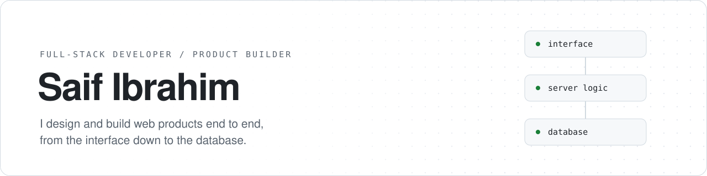

<picture>
  <source media="(prefers-color-scheme: dark)" srcset="./assets/banner-dark.svg">
  
</picture>

  
  

 

## About

I build complete products: I scope the idea, design the interface, model the data, write the backend logic and ship it to production. Most of my work is full-stack TypeScript on React and Supabase, with the database doing the heavy lifting: business rules, permissions and money operations live in PostgreSQL, not in the browser.

I work on my own products and on client platforms, from offline-first apps to membership stores with their own admin panels.

<table>
  <tr>
    <td width="33%" valign="top"><b>Focus</b> Full-stack web applications, e-commerce and admin dashboards</td>
    <td width="33%" valign="top"><b>Approach</b> Understand the problem, plan the data, then build frontend, backend and integrations as one system</td>
    <td width="33%" valign="top"><b>Currently</b> Building and maintaining production platforms alongside my own products</td>
  </tr>
</table>

 

## Featured Projects

<table>
  <tr>
    <td width="50%" valign="top">
      <h3>FlowCash</h3>
      <code>PERSONAL PRODUCT</code> &nbsp; <code>FULL-STACK</code>
      
An offline-first personal finance PWA for expenses, income, budgets, savings goals, debts and subscriptions across several payment sources. Installs on Android as a real app.

      
<b>My role</b> Designed and built the whole product, from UI to database and deployment.

      
<b>Highlights</b> Every money operation runs through atomic PostgreSQL functions, so balances stay correct under simultaneous updates. Row-Level Security on all user data, a custom service worker for offline use, CSV/PDF export and backup.

      
React 19 · TanStack Start · TypeScript · Supabase · PostgreSQL · Tailwind CSS

      
<a href="https://flow-cash.vercel.app">Live app</a> &nbsp;·&nbsp; <a href="https://saifibrahim.vercel.app/projects/flowcash">Case study</a>

    </td>
    <td width="50%" valign="top">
      <h3>Blackframe Studio</h3>
      <code>CLIENT PLATFORM</code> &nbsp; <code>FULL-STACK</code>
      
An asset platform for DaVinci Resolve editors: free plugins, LUTs, footage and sound, plus a paid Studio membership with its own store, pricing, downloads and customer accounts.

      
<b>My role</b> Developer of the platform. Built the web app, customer accounts, membership checkout integration, protected file delivery and the admin control room the team uses to run the site.

      
<b>Highlights</b> Access and download rules enforced in the database, not the UI. Role-based admin panel, team-editable content and page sections, server-side rendering with full SEO.

      
React 19 · TanStack Start · TypeScript · Supabase · Cloudflare Workers · Tailwind CSS · Vitest

      
<a href="https://blackframe.in">Live site</a>

    </td>
  </tr>
  <tr>
    <td width="50%" valign="top">
      <h3>Farely</h3>
      <code>PERSONAL PRODUCT</code> &nbsp; <code>OFFLINE-FIRST</code>
      
A transit wallet for tracking Abu Dhabi Hafilat bus card balances. Record a trip in two taps, see the expected balance, and stay in sync across devices with or without a connection.

      
<b>My role</b> Designed and built it end to end: product scope, UI/UX, data model, sync architecture, database security and deployment.

      
<b>Highlights</b> Balances are always derived from an auditable ledger, never stored. A persistent outbox and sync engine handle offline edits, conflicts and multi-device IDs.

      
React 19 · TanStack Start · TypeScript · Supabase (Postgres, Auth, Realtime) · Zod

      
<a href="https://farely-hafelat.vercel.app">Live app</a> &nbsp;·&nbsp; <a href="https://saifibrahim.vercel.app/projects/farely">Case study</a>

    </td>
    <td width="50%" valign="top">
      <h3>S &amp; E Fashion Store</h3>
      <code>E-COMMERCE</code> &nbsp; <code>SHOPIFY</code>
      
An online fashion store with a modern, fashion-focused identity and a simple shopping flow, from browsing collections to product details and checkout.

      
<b>My role</b> Built the storefront structure, UI and responsive layout on a customized Shopify theme.

      
<b>Highlights</b> A distinct visual identity on top of Shopify's theme system, kept consistent across collections, product pages and navigation on every screen size.

      
Shopify · HTML · CSS · JavaScript

      
<a href="https://saifibrahim.vercel.app/projects/se-fashion-store">Case study</a>

    </td>
  </tr>
</table>

Client work lives in private repositories. Descriptions cover my role and the public product only. More on my <a href="https://saifibrahim.vercel.app/#projects">portfolio</a>.

 

## Full-Stack &amp; Backend

The part of the work I care about most is what happens behind the interface.

<table>
  <tr>
    <td width="50%" valign="top"><b>Logic in the database</b> Business rules, balances and access checks as PostgreSQL functions, triggers and Row-Level Security, so they hold no matter which client calls them.</td>
    <td width="50%" valign="top"><b>Auth and permissions</b> Customer accounts and role-based admin panels, enforced on the server rather than hidden in the UI.</td>
  </tr>
  <tr>
    <td width="50%" valign="top"><b>Offline-first data</b> Local-first interfaces with queued changes, background sync and conflict handling.</td>
    <td width="50%" valign="top"><b>Payments and commerce</b> Hosted checkout integrations with verified webhooks and server-side access decisions.</td>
  </tr>
  <tr>
    <td width="50%" valign="top"><b>Server functions and delivery</b> Edge and server functions, protected file downloads and admin tooling for non-technical teams.</td>
    <td width="50%" valign="top"><b>Production details</b> Server-side rendering, SEO and structured data, bilingual English/Arabic (RTL), deployment on Vercel and Cloudflare.</td>
  </tr>
</table>

 

## Tech Stack

  <picture>
    <source media="(prefers-color-scheme: dark)" srcset="https://skillicons.dev/icons?i=ts,js,html,css,react,vite,tailwind&theme=dark&perline=7">
    
  </picture>
   
  <picture>
    <source media="(prefers-color-scheme: dark)" srcset="https://skillicons.dev/icons?i=nodejs,supabase,postgres,mongodb,deno,vercel,cloudflare,git,github,vitest&theme=dark&perline=10">
    
  </picture>

<table>
  <tr>
    <td><b>Frontend</b></td>
    <td>TypeScript · JavaScript · React · TanStack Start · Vite · Tailwind CSS · shadcn/ui · HTML · CSS</td>
  </tr>
  <tr>
    <td><b>Backend &amp; Data</b></td>
    <td>Supabase · PostgreSQL · SQL functions &amp; RLS · Edge Functions · Node.js · REST APIs · MongoDB</td>
  </tr>
  <tr>
    <td><b>Platforms &amp; Tools</b></td>
    <td>Vercel · Cloudflare Workers · Shopify · Git · GitHub · Vitest</td>
  </tr>
</table>

 

## GitHub Activity

  <picture>
    <source media="(prefers-color-scheme: dark)" srcset="https://github-readme-stats.vercel.app/api?username=saiiff25&show_icons=true&hide_border=true&hide_rank=true&bg_color=00000000&title_color=F0F6FC&text_color=9198A1&icon_color=3FB950">
    
  </picture>
  <picture>
    <source media="(prefers-color-scheme: dark)" srcset="https://streak-stats.demolab.com?user=saiiff25&hide_border=true&background=00000000&ring=3FB950&fire=3FB950&currStreakNum=F0F6FC&sideNums=F0F6FC&currStreakLabel=F0F6FC&sideLabels=9198A1&dates=9198A1&stroke=30363D">
    
  </picture>

Most of my work lives in private repositories, so public numbers show only part of it.

 

## Get in Touch

Have a product to build or a platform that needs a developer? I'm open to projects and collaborations.

  <a href="https://saifibrahim.vercel.app"><b>Portfolio</b></a> &nbsp;·&nbsp;
  <a href="mailto:saif.ibrahim3070@gmail.com"><b>saif.ibrahim3070@gmail.com</b></a>

